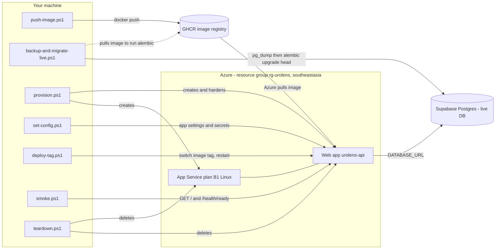

# UroLens Azure deploy scripts

PowerShell 7 scripts that put the backend container on Azure App Service. The database stays on
Supabase. Every script has a header explaining what it does, when to run it, and the AWS equivalent,
and every script supports `-DryRun` (prints the commands, runs nothing).

> **Unverified flags:** these scripts were written without the Azure CLI installed, so the `az`
> flags were not checked against `az <cmd> --help`. Run `az version` and check the flagged commands
> (marked below) before the first real run.

## Run order and who runs what

| # | Script | Who runs it | When | Needs |
|---|--------|-------------|------|-------|
| 1 | `push-image.ps1 -Tag v1.1.0` | Developer cutting the release | Every release | Docker, git tag, GHCR write PAT (`-Login`) |
| 2 | `backup-and-migrate-live.ps1 -Tag v1.1.0` | Whoever holds the live DB URL | Releases with migrations, before step 5 | Docker, pull access to the image |
| 3 | `provision.ps1 -Tag v1.1.0` | Azure subscription owner/contributor | Once (re-runnable) | `az login`, GHCR **read-only** PAT |
| 4 | `set-config.ps1` | Same person as 3 | After 3; again on any config change | `settings.env` filled in, 5 secrets |
| 5 | `deploy-tag.ps1 -Tag v1.1.0` | Whoever deploys | Every release | Image already pushed |
| 6 | `smoke.ps1 [-Domain api.urolens.tech]` | Anyone | After 4, 5, DNS | Network only |
| – | `teardown.ps1` | Subscription owner | To stop billing | Type the app name |

First-time order: **1 → 2 (if migrations) → 3 → 4 → 6**. Every later release: **1 → 2 → 5 → 6**.

Before step 4: put the Supabase project URL in `deploy/settings.env`. Optionally copy
`secrets.local.env.example` to `secrets.local.env` (gitignored) to skip the secret prompts.
**`ENCRYPTION_KEY` and `DEDUP_HASH_KEY` must equal the values the live system uses**, otherwise
existing encrypted patient fields cannot be decrypted and duplicate detection breaks.

## Secrets

No script contains a secret. Secrets come from hidden prompts or `deploy/secrets.local.env`. They are
never printed (dry-run and real-run output show `********` or nothing). Two things to know: the
`provision.ps1` PAT is passed to `az` as an argument, so it is briefly visible in your local process
list; and `set-config.ps1` writes a temp JSON file with the secrets and deletes it immediately after.

## Cost notes

- A B1 Linux plan is billed hourly **while the plan exists**, even if the app is stopped or idle. Rough
  order of magnitude is low tens of USD per month; check the Azure pricing calculator for
  Southeast Asia for the real figure.
- Deleting the web app alone does **not** stop billing; the plan must go too (`teardown.ps1` does both).
- No ACR, no Application Insights, no Azure DNS: those are the extra costs avoided here. GHCR and
  Supabase are billed (or free) outside Azure.
- One instance and no autoscale, so the bill is flat and there is no redundancy: a restart means a
  short outage while the AI model reloads.

## DNS records for api.urolens.tech

The domain is managed outside Azure, at your DNS provider. Create two records:

| Type | Name | Value |
|------|------|-------|
| CNAME | `api` | `urolens-api.azurewebsites.net` (confirm with `smoke.ps1` output or `az webapp show --query defaultHostName`) |
| TXT | `asuid.api` | the app's custom domain verification ID: `az webapp show -n urolens-api -g rg-urolens --query customDomainVerificationId -o tsv` |

After DNS has propagated, attach the domain and a free managed certificate. These two steps are **not
scripted** (you did not ask for it) and the commands are unverified:

```powershell
az webapp config hostname add --webapp-name urolens-api --resource-group rg-urolens --hostname api.urolens.tech
az webapp config ssl create --name urolens-api --resource-group rg-urolens --hostname api.urolens.tech
# then bind the certificate using the thumbprint it returns:
az webapp config ssl bind --name urolens-api --resource-group rg-urolens --certificate-thumbprint <thumbprint> --ssl-type SNI
```

Then verify with `pwsh deploy/smoke.ps1 -Domain api.urolens.tech`.

## How it works



### Azure to AWS glossary

| Azure term | AWS term |
|------------|----------|
| Subscription | AWS account |
| Resource group | CloudFormation stack / tag group (a deletable folder of resources) |
| Region (`southeastasia`) | Region (`ap-southeast-1`) |
| App Service plan | The EC2 capacity behind Elastic Beanstalk |
| Web app (App Service) | Elastic Beanstalk environment / App Runner service |
| SKU `B1` | Instance type (e.g. `t3.small`) |
| App setting | Environment variable (Beanstalk option setting / ECS task env) |
| Always On | No equivalent needed (AWS containers do not idle-unload) |
| Health check path | Target group health check path |
| HTTPS Only | ALB listener redirect 80 → 443 |
| Minimum TLS version | ALB TLS security policy |
| GHCR (GitHub Container Registry) | ECR (Elastic Container Registry) |
| `az login` | `aws configure` / `aws sso login` |
| Managed certificate | ACM certificate |
| `asuid` TXT record | ACM DNS validation CNAME |
| `az webapp log tail` | `aws logs tail` (CloudWatch Logs) |
